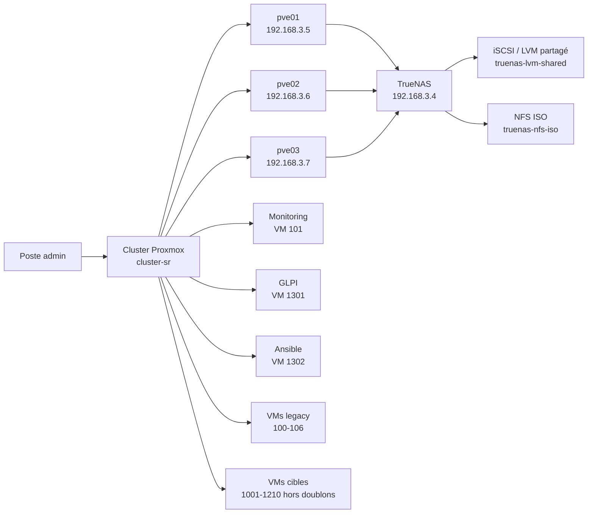
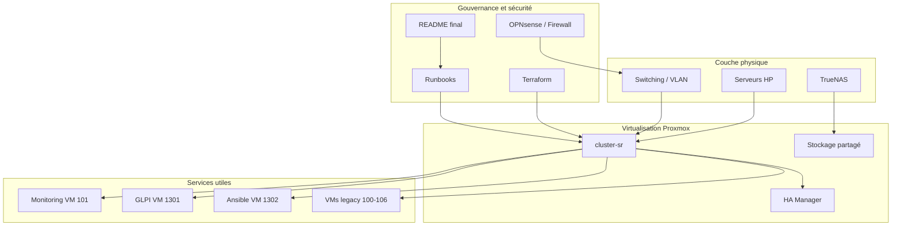
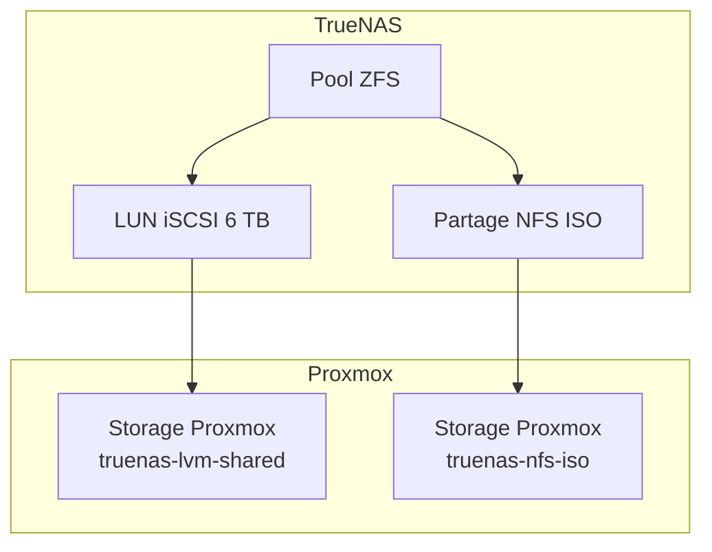
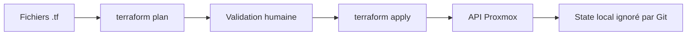
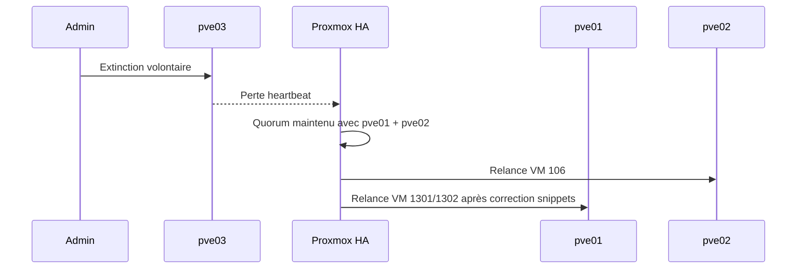
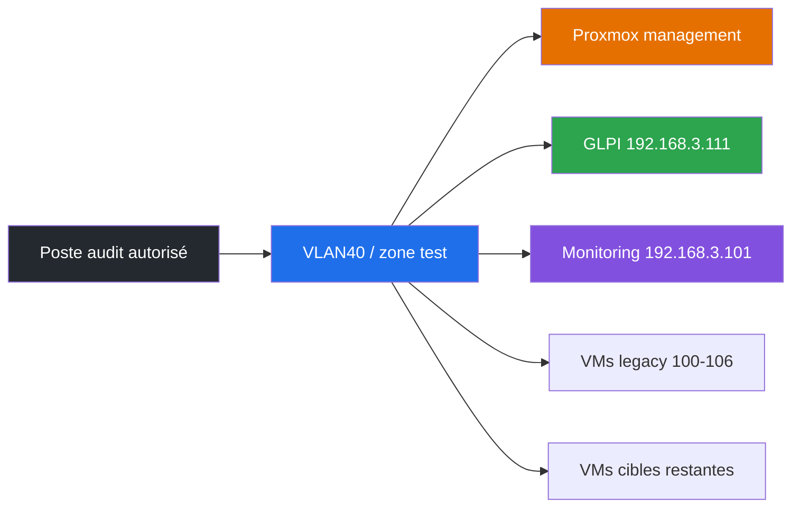
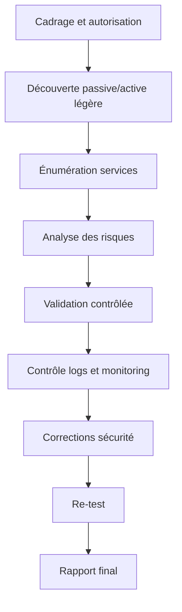

# Showroom HP — Documentation finale du projet

> Projet d'infrastructure, virtualisation, automatisation et sécurité pour un lab Showroom HP.  
> Dernière mise à jour : 2026-06-24.

<p align="center">
  
  
  
  
  
  
</p>

## Résumé exécutif

Le projet **Showroom HP** a permis de construire et documenter une plateforme on-premise réaliste, basée sur un cluster **Proxmox VE** à trois nœuds, un stockage partagé **TrueNAS**, une automatisation **Terraform/Ansible**, une instance **GLPI**, un monitoring existant et des fondations de durcissement réseau.

Le résultat est un environnement exploitable pour démonstrations, tests techniques, inventaire IT, scénarios de haute disponibilité et préparation sécurité.

## Sommaire

- [Architecture globale](#architecture-globale)
- [État final](#état-final)
- [Nœuds Proxmox](#nœuds-proxmox)
- [Stockage](#stockage)
- [Chronologie détaillée](#chronologie-détaillée)
- [Journal des commandes exécutées](#journal-des-commandes-exécutées)
- [Virtualisation](#virtualisation)
- [Terraform](#terraform)
- [Ansible](#ansible)
- [GLPI](#glpi)
- [Monitoring](#monitoring)
- [Haute disponibilité](#haute-disponibilité)
- [Sécurité](#sécurité)
- [Sécurité offensive contrôlée](#sécurité-offensive-contrôlée)
- [OPNsense et réseau](#opnsense-et-réseau)
- [Publication GitHub](#publication-github)
- [Prochaines étapes](#prochaines-étapes)

## Architecture globale



## Vue fonctionnelle



## État final

| Domaine | État |
|---|---|
| Cluster Proxmox | 3 nœuds, quorum OK |
| Stockage partagé | TrueNAS iSCSI/LVM actif sur les nœuds |
| ISO/images | NFS TrueNAS actif |
| VMs legacy | `100-106` conservées, HA opérationnel |
| Monitoring | VM `101 monitoring` active |
| GLPI | VM `1301 vm-glpi`, HTTP validé |
| Ansible | VM `1302 vm-ansible`, bootstrap terminé |
| Doublons | `1000`, `1003`, `1006`, `1100`, `1300` supprimés |
| Terraform | 42 ressources, configuration valide, plan final sans changement |
| Documentation | README final publié comme documentation principale |

## Nœuds Proxmox

| Nœud | IP | Rôle | État |
|---|---:|---|---|
| `pve01` | `192.168.3.5` | Nœud principal / HA actif | OK |
| `pve02` | `192.168.3.6` | Nœud secondaire / HA actif | OK |
| `pve03` | `192.168.3.7` | Nœud testé en extinction | OK après correction iSCSI |

## Stockage



Réalisé :

- création et validation du stockage `truenas-lvm-shared` ;
- migration des disques VM vers le stockage partagé ;
- stockage ISO NFS opérationnel ;
- validation de `pve-shared` après redémarrage de `pve03` ;
- correction du service `open-iscsi` sur `pve03` après test d'extinction ;
- validation finale du stockage sur le cluster.

## Chronologie détaillée

### Phase 1 — Création du cluster Proxmox

Situation initiale :

- `pve01` existait comme nœud principal ;
- `pve02` était disponible pour rejoindre le cluster ;
- `pve03` n'était pas encore intégré au périmètre final.

Réalisé :

- préparation de la résolution inter-nœuds ;
- jointure de `pve02` au cluster ;
- validation du quorum ;
- stabilisation du premier socle Proxmox.

Résultat : cluster initial fonctionnel, base prête pour l'ajout du troisième nœud.

### Phase 2 — Durcissement d'accès

Réalisé :

- génération et déploiement de clés SSH administrateur ;
- passage de l'accès root SSH en mode clé uniquement ;
- création du compte nommé `bkh@pve` ;
- création d'un token API pour l'automatisation ;
- préparation du firewall datacenter avec allowlist d'administration et flux cluster.

Résultat : accès d'administration plus propre, compatible avec Terraform et les runbooks d'exploitation.

### Phase 3 — Intégration de `pve03` et TrueNAS

Réalisé :

- intégration de `pve03` au cluster final `cluster-sr` ;
- standardisation des IPs Proxmox ;
- connexion à TrueNAS ;
- création du stockage NFS pour les ISOs ;
- création de la cible iSCSI pour les disques VM.

Résultat : cluster à trois nœuds avec stockage centralisé.

### Phase 4 — Migration vers stockage partagé

La solution retenue pour les disques VM est :

```text
TrueNAS zvol 6 TB
→ cible iSCSI
→ LVM Proxmox pve-shared
→ storage truenas-lvm-shared
```

Réalisé :

- abandon des approches non adaptées au besoin HA ;
- création du volume LVM partagé ;
- migration progressive des disques VM ;
- extension du stockage jusqu'à 6 TB ;
- configuration de l'auto-login iSCSI ;
- ajout de la détection automatique du VG au boot.

Résultat : les VMs peuvent être relocalisées entre nœuds avec accès au même stockage.

### Phase 5 — Haute disponibilité

Réalisé :

- activation HA sur les VMs legacy critiques ;
- validation du quorum à trois nœuds ;
- test de live migration ;
- test de perte de nœud ;
- correction du comportement HA pour les VMs cloud-init.

Résultat : HA validée, avec un point d'attention identifié puis corrigé sur les snippets cloud-init.

### Phase 6 — Tests de validation

| Test | Résultat |
|---|---|
| Live migration | Validée |
| Failover HA | Validé |
| Extinction volontaire de `pve03` | Quorum conservé |
| Retour de `pve03` | iSCSI corrigé puis validé |
| Terraform final | `No changes` |
| GLPI HTTP | `200 OK` |
| Ansible vers GLPI/Ansible | `pong` |

### Phase 7 — Infrastructure as Code

Réalisé avec Terraform :

- création du catalogue de VMs ;
- création des VMs ISO ;
- création des VMs Linux cloud-init ;
- import des VMs legacy ;
- protection des VMs legacy ;
- suppression logique et réelle des doublons ;
- stabilisation du plan final.

État final : Terraform gère l'intention actuelle sans vouloir recréer les doublons supprimés.

### Phase 8 — Test d'extinction de `pve03`

Observation :

- le cluster est resté quorate avec `pve01` et `pve02` ;
- la VM `106` a été relancée par HA ;
- les VMs cloud-init ont révélé une dépendance aux snippets stockés en local.

Correction :

- synchronisation des snippets utiles sur les nœuds ;
- retrait du doublon `1300` ;
- relance et validation des VMs utiles ;
- réparation d'`open-iscsi` au retour de `pve03`.

Résultat : incident compris, corrigé et documenté dans le README.

### Phase 9 — Documentation finale et publication

Réalisé :

- consolidation de la documentation finale dans ce README ;
- suppression des fichiers de documentation de travail remplacés ;
- exclusion des fichiers sensibles et lourds ;
- création d'un nouveau dépôt GitHub privé dédié ;
- publication minimale : `README.md` et `.gitignore` uniquement.

Résultat : le dépôt GitHub sert de vitrine documentaire propre sans publier les sources sensibles du lab.

## Journal des commandes exécutées

Les commandes ci-dessous reprennent les commandes exécutées ou utilisées pendant le projet. Les secrets, tokens, mots de passe et clés privées sont remplacés par des placeholders.

### Phase 1 — Création et validation du cluster

```bash
hostname
hostname -f
cat /etc/hosts
pvecm status
pvecm nodes
```

Jointure d'un nœud au cluster :

```bash
pvecm add <IP_DU_NOEUD_EXISTANT>
pvecm status
pvecm nodes
```

Jointure via API Proxmox, utilisée dans le runbook initial :

```bash
curl -k -X POST "https://<PVE_IP>:8006/api2/json/cluster/config/join" \
  -H "CSRFPreventionToken: <CSRF_TOKEN>" \
  -H "Cookie: PVEAuthCookie=<AUTH_COOKIE>" \
  --data-urlencode "hostname=<NEW_NODE_IP>" \
  --data-urlencode "password=<ROOT_PASSWORD>" \
  --data-urlencode "fingerprint=<TLS_FINGERPRINT>"
```

### Phase 2 — Durcissement SSH et accès Proxmox

```bash
ssh-keygen -t ed25519 -C "bkh@pop-os-admin"
ssh-copy-id root@192.168.3.5
ssh-copy-id root@192.168.3.6
ssh-copy-id root@192.168.3.7
```

Durcissement SSH :

```bash
sed -i 's/^#\?PermitRootLogin.*/PermitRootLogin prohibit-password/' /etc/ssh/sshd_config
systemctl restart ssh
ssh -o BatchMode=yes root@192.168.3.5 "hostname && whoami"
```

Compte nommé et token API :

```bash
pveum user add bkh@pve --comment "Named admin account"
pveum aclmod / -user bkh@pve -role Administrator
pveum user token add root@pam automation --privsep 0
pveum aclmod / -token root@pam!automation -role Administrator
```

Contrôle firewall Proxmox :

```bash
pve-firewall status
pve-firewall compile
pve-firewall restart
```

### Phase 3 — Intégration TrueNAS NFS et iSCSI

Découverte iSCSI :

```bash
iscsiadm -m discovery -t sendtargets -p 192.168.3.4
iscsiadm -m node -T iqn.2005-10.org.freenas.ctl:iscsi-vm -p 192.168.3.4:3260 --login
iscsiadm -m session
```

Activation au démarrage :

```bash
systemctl enable --now open-iscsi
systemctl status open-iscsi --no-pager
```

Ajout du stockage ISO NFS :

```bash
pvesm add nfs truenas-nfs-iso \
  --server 192.168.3.4 \
  --export /mnt/<POOL>/<DATASET_ISO> \
  --content iso,backup,images

pvesm status
```

### Phase 4 — Création du LVM partagé

Identification du disque :

```bash
lsblk
ls -l /dev/disk/by-path/
```

Création du PV/VG :

```bash
pvcreate /dev/<DISQUE_ISCSI>
vgcreate pve-shared /dev/<DISQUE_ISCSI>
vgs
vgdisplay pve-shared
```

Ajout dans Proxmox :

```bash
pvesm add lvm truenas-lvm-shared \
  --vgname pve-shared \
  --content images,rootdir \
  --shared 1

pvesm status
```

Rescan et détection après reboot :

```bash
iscsiadm -m session --rescan
pvscan --cache
vgdisplay pve-shared
pvesm status
```

Correction appliquée au retour de `pve03` :

```bash
iscsiadm -m node -T iqn.2005-10.org.freenas.ctl:iscsi-vm -p 192.168.3.4:3260 --login
pvscan --cache
vgdisplay pve-shared
systemctl reset-failed open-iscsi
systemctl start open-iscsi
systemctl is-active open-iscsi
```

### Phase 5 — Migration disques et HA

Migration de disques vers le stockage partagé :

```bash
qm config <VMID>
qm move_disk <VMID> scsi0 truenas-lvm-shared --delete 1
qm rescan
qm config <VMID>
```

Création et consultation HA :

```bash
ha-manager status
ha-manager config
ha-manager add vm:<VMID> --state started --group prod-nodes
ha-manager set vm:<VMID> --state started
```

Live migration :

```bash
qm migrate 103 pve01 --online
ha-manager status
qm status 103
```

Test HA encadré :

```bash
systemctl stop corosync
ha-manager status
pvecm status
systemctl start corosync
```

### Phase 6 — Terraform

Initialisation et validation :

```bash
cd terraform
terraform init
terraform fmt -check
terraform validate
terraform plan
```

Création des lots VM :

```bash
terraform plan -out=plan-vms.tfplan
terraform apply plan-vms.tfplan
```

Import des VMs legacy :

```bash
terraform import 'proxmox_virtual_environment_vm.legacy_vms["legacy-auth"]' 100
terraform import 'proxmox_virtual_environment_vm.legacy_vms["legacy-monitoring"]' 101
terraform import 'proxmox_virtual_environment_vm.legacy_vms["legacy-inventory"]' 102
terraform import 'proxmox_virtual_environment_vm.legacy_vms["legacy-hp-print-mgmt"]' 103
terraform import 'proxmox_virtual_environment_vm.legacy_vms["legacy-ts"]' 104
terraform import 'proxmox_virtual_environment_vm.legacy_vms["legacy-db"]' 105
```

Inspection du state :

```bash
terraform state list | sort
terraform state show 'proxmox_virtual_environment_vm.linux_vms["vm-glpi"]'
terraform output
```

Plan final utilisé après correction des doublons :

```bash
terraform fmt -check legacy_vms.tf linux_vms.tf locals.tf outputs.tf providers.tf variables.tf vms.tf
terraform validate
terraform plan -refresh=false -no-color
```

### Phase 7 — Cloud-init et snippets

Préparation du stockage snippets :

```bash
for NODE in 192.168.3.5 192.168.3.6 192.168.3.7; do
  ssh root@$NODE "pvesm set local --content vztmpl,iso,backup,snippets"
done
```

Synchronisation des snippets utiles :

```bash
./scripts/proxmox-sync-cloud-init-snippets.sh
```

Commandes utilisées par le script :

```bash
ssh root@<NODE> "mkdir -p /var/lib/vz/snippets"
scp terraform/cloud-init/glpi.yaml root@<NODE>:/var/lib/vz/snippets/ci-vm-glpi.yaml
scp terraform/cloud-init/ansible.yaml root@<NODE>:/var/lib/vz/snippets/ci-vm-ansible.yaml
```

### Phase 8 — Test d'extinction `pve03`

État cluster avant/après :

```bash
pvecm status
ha-manager status
pvesm status
```

Vérification réseau et stockage au retour de `pve03` :

```bash
ssh root@192.168.3.7 "hostname"
ssh root@192.168.3.7 "systemctl is-active open-iscsi"
ssh root@192.168.3.7 "iscsiadm -m session"
ssh root@192.168.3.7 "pvesm status"
ssh root@192.168.3.7 "vgs && lvs"
```

### Phase 9 — Ansible et GLPI

Tests de connectivité :

```bash
cd ansible
ansible linux -m ping
ansible vm-glpi -m ping
ansible vm-ansible -m ping
```

Correction des clés hôtes après relocalisation HA :

```bash
ssh-keyscan -T 8 -t ed25519,rsa 192.168.3.111
ssh-keyscan -T 8 -t ed25519,rsa 192.168.3.112
```

Installation GLPI :

```bash
ansible-playbook playbooks/glpi-foundation.yml --syntax-check
ansible-playbook playbooks/glpi-foundation.yml
```

Validation GLPI :

```bash
curl -I --max-time 8 http://192.168.3.111
ansible vm-glpi -b -m shell -a 'cd /var/www/glpi && sudo -u www-data php bin/console glpi:system:check_requirements'
ansible vm-glpi -b -m shell -a 'test ! -f /var/www/glpi/install/install.php && echo installer-removed'
```

Rotation du mot de passe DB :

```bash
ansible-playbook playbooks/glpi-rotate-db-password.yml
```

### Phase 10 — Suppression des doublons

Plan de suppression :

```bash
terraform plan -refresh=false -no-color -out=remove-duplicate-vms.tfplan
terraform apply -no-color remove-duplicate-vms.tfplan
```

Nettoyage de références orphelines :

```bash
terraform state rm 'proxmox_haresource.linux_vms["vm-monitoring"]'
terraform state rm 'proxmox_virtual_environment_vm.linux_vms["vm-monitoring"]'
```

Nettoyage des snippets orphelins :

```bash
for node in 192.168.3.5 192.168.3.6 192.168.3.7; do
  ssh root@$node 'rm -f /var/lib/vz/snippets/ci-vm-monitoring.yaml'
done
```

Vérification finale :

```bash
pvesh get /cluster/resources --type vm | grep -E '(^|[^0-9])(1000|1003|1006|1100|1300)([^0-9]|$)' || true
ha-manager status
terraform state list | grep -E 'vm-monitoring|vms\["(AUTH|SQL|TS|HP-PRINT-MGMT)"\]' || true
terraform plan -refresh=false -no-color
```

### Phase 11 — Publication GitHub minimale

Création du dépôt privé :

```bash
gh repo create bilkl/showroom-hp-infrastructure \
  --private \
  --description "Documentation finale et infrastructure as code du projet Showroom HP"
```

Création du dépôt local séparé :

```bash
git --git-dir=.repo-git --work-tree=. init
git --git-dir=.repo-git --work-tree=. branch -m main
git --git-dir=.repo-git --work-tree=. remote add origin https://github.com/bilkl/showroom-hp-infrastructure.git
```

Publication volontairement limitée :

```bash
git --git-dir=.repo-git --work-tree=. add README.md .gitignore
git --git-dir=.repo-git --work-tree=. commit -m "Add final showroom HP documentation"
git --git-dir=.repo-git --work-tree=. push -u origin main
```

Vérification GitHub :

```bash
gh api repos/bilkl/showroom-hp-infrastructure/git/trees/main?recursive=1 --jq '.tree[].path'
gh repo view bilkl/showroom-hp-infrastructure --json nameWithOwner,visibility,url,defaultBranchRef
```

## Virtualisation

### VMs legacy conservées

Ces VMs existaient déjà et restent les références de production. Elles sont importées dans Terraform avec protection `ignore_changes = all`.

| VMID | Nom | Rôle | État |
|---:|---|---|---|
| 100 | `auth` | Authentification / infra | Running |
| 101 | `monitoring` | Grafana, Prometheus, InfluxDB | Running |
| 102 | `inventory-app` | Inventaire existant | Running |
| 103 | `hp-print-mgmt` | Gestion impression HP | Running |
| 104 | `TS` | Terminal server | Running |
| 105 | `DB` | Base de données | Running |
| 106 | `3cx` | Téléphonie | Running |

### VMs Terraform restantes

| Lot | VMID | État |
|---|---:|---|
| Infrastructure Windows | `1001-1009` hors doublons | Créées, OS à installer |
| Impression / solutions HP | `1101-1111` | Créées, OS à installer |
| Clients de démonstration | `1200-1210` | Créées, OS à installer |
| Linux cloud-init | `1301-1302` | Actives |

### Doublons supprimés

| VM supprimée | Doublon de | Décision |
|---:|---|---|
| `1000 AUTH` | `100 auth` | Supprimée |
| `1003 SQL` | `105 DB` | Supprimée |
| `1006 TS` | `104 TS` | Supprimée |
| `1100 HP-PRINT-MGMT` | `103 hp-print-mgmt` | Supprimée |
| `1300 vm-monitoring` | `101 monitoring` | Supprimée |

## Terraform

Terraform décrit l'infrastructure Proxmox reproductible.



Réalisé :

- provider `bpg/proxmox` configuré ;
- catalogue VM dans `terraform/locals.tf` ;
- création des VMs ISO ;
- création des VMs Linux cloud-init ;
- import des VMs legacy `100-105` ;
- protection des VMs legacy avec `ignore_changes = all` ;
- ajout des filtres `local.active_vms` et `local.active_linux_vms` pour éviter de recréer les doublons supprimés ;
- correction du drift HA en ignorant `node_name` pour les VMs Linux ;
- état final validé avec `terraform plan -refresh=false` : **No changes**.

Fichiers importants :

| Fichier | Rôle |
|---|---|
| `terraform/locals.tf` | Catalogue VM et filtres des VMs actives |
| `terraform/vms.tf` | VMs ISO |
| `terraform/linux_vms.tf` | VMs Debian cloud-init |
| `terraform/legacy_vms.tf` | Import/protection des VMs legacy |
| `terraform/outputs.tf` | Sorties Terraform propres |

Sécurité Git :

- `terraform.tfvars` ignoré ;
- `*.tfstate` ignoré ;
- `*.tfplan` ignoré ;
- `.terraform/` ignoré ;
- l'ISO Proxmox et les fichiers Excel locaux sont ignorés.

## Ansible

Ansible sert à administrer les VMs Linux et à automatiser les services.

Réalisé :

- inventaire dans `ansible/inventory/hosts.yml` ;
- configuration SSH dédiée dans `ansible/ansible.cfg` ;
- correction des clés SSH connues après relocalisation HA ;
- bootstrap de `vm-ansible` ;
- installation complète de GLPI ;
- playbook de rotation du mot de passe DB GLPI ;
- playbook monitoring conservé uniquement pour nouvelle cible éventuelle.

Playbooks :

| Playbook | Usage |
|---|---|
| `ansible/playbooks/bootstrap-ansible-node.yml` | Préparation de `vm-ansible` |
| `ansible/playbooks/glpi-foundation.yml` | Installation GLPI complète |
| `ansible/playbooks/glpi-rotate-db-password.yml` | Rotation du mot de passe DB GLPI |
| `ansible/playbooks/monitoring-stack.yml` | Stack monitoring pour nouvelle cible uniquement |

## GLPI

GLPI est installé sur `vm-glpi`.

| Élément | Valeur |
|---|---|
| VMID | `1301` |
| IP | `192.168.3.111` |
| Version | `11.0.7` |
| Web | `http://192.168.3.111` |
| Serveur web | Nginx |
| PHP | PHP-FPM |
| Base | MariaDB |

Réalisé :

- installation GLPI via Ansible ;
- création de la base MariaDB ;
- génération du mot de passe DB côté VM ;
- rotation du mot de passe applicatif après installation ;
- suppression de l'installateur web ;
- validation HTTP `200 OK` ;
- validation des prérequis GLPI requis.

Reste à faire :

- changer les comptes par défaut ;
- importer l'inventaire matériel et VM ;
- structurer les catégories d'actifs ;
- documenter les affectations.

## Monitoring

Le monitoring actif est la VM legacy `101 monitoring`.

| Service | État |
|---|---|
| SSH | Validé |
| Grafana `3000` | Validé |
| Prometheus `9090` | Validé |
| InfluxDB `8086` | Validé |

Décision : le doublon `1300 vm-monitoring` a été supprimé.

## Haute disponibilité

Un test d'extinction de `pve03` a été réalisé.



Résultat :

- quorum conservé ;
- HA fonctionnelle ;
- incident identifié sur snippets cloud-init stockés en local ;
- script de synchronisation créé ;
- `pve03` réintégré ;
- iSCSI corrigé et validé ;
- doublon `1300` retiré.

Un rapport détaillé local a été conservé dans l'espace de travail projet.

## Sécurité

Réalisé :

- durcissement SSH ;
- accès root par mot de passe désactivé ;
- compte nommé `bkh@pve` créé ;
- token API d'automatisation créé ;
- baseline OPNsense préparée ;
- firewall datacenter Proxmox préparé ;
- runbook TOTP rédigé ;
- secrets et states Terraform exclus du dépôt Git.

Reste à faire :

- activer TOTP sur `bkh@pve` ;
- valider la politique firewall Proxmox en mode `DROP` avec accès de secours ;
- confirmer le rôle final du VLAN40 ;
- appliquer progressivement la baseline OPNsense.

## Sécurité offensive contrôlée

Cette partie ajoute une dimension **offensive / purple team** au projet, mais uniquement dans un cadre autorisé, documenté et non destructif. L'objectif n'est pas de "casser" l'infrastructure : l'objectif est de vérifier l'exposition réelle, améliorer la segmentation, alimenter GLPI, tester les détections et produire des preuves techniques propres.

### Objectifs

| Objectif | Résultat attendu |
|---|---|
| Cartographier l'exposition | Liste des hôtes, ports et services réellement visibles |
| Valider la segmentation | Vérifier quels flux passent entre VLANs/zones |
| Identifier les faiblesses | Services inutiles, versions obsolètes, ports ouverts |
| Tester les détections | Générer des événements visibles côté logs/monitoring |
| Alimenter GLPI | Transformer les découvertes en inventaire/action |
| Produire un rapport | Risques, preuves, recommandations, priorités |

### Règles d'engagement

| Règle | Décision |
|---|---|
| Périmètre | Réseaux et VMs explicitement autorisés du lab Showroom HP |
| Hors périmètre | Internet, clients réels, données utilisateurs, équipements non validés |
| Intensité | Scans légers, pas de déni de service |
| Exploitation | Uniquement validation contrôlée après accord humain |
| Identifiants | Pas de brute force, pas de password spraying |
| Malware | Interdit |
| Persistance | Interdite |
| Exfiltration | Interdite |
| Traçabilité | Chaque test doit avoir date, cible, outil, résultat, impact |
| Arrêt d'urgence | Stop immédiat si latence, panne, alerte ou impact métier |

### Périmètre de test recommandé



### Méthodologie offensive



### Phases de test

| Phase | Description | Livrable |
|---|---|---|
| 1. Cadrage | Valider le périmètre, les horaires et les exclusions | Fiche d'autorisation |
| 2. Découverte | Identifier les hôtes actifs | Liste des assets |
| 3. Énumération | Identifier ports, services, versions | Matrice services |
| 4. Analyse | Classer les risques par criticité | Backlog sécurité |
| 5. Validation | Confirmer sans impact destructif | Preuves contrôlées |
| 6. Détection | Vérifier les traces dans logs/monitoring | Captures/logs |
| 7. Correction | Fermer ports, patcher, filtrer, documenter | Plan d'action |
| 8. Re-test | Confirmer la réduction d'exposition | Rapport comparatif |

### Commandes de reconnaissance non destructives

Toutes les commandes ci-dessous doivent être exécutées uniquement depuis un poste d'audit autorisé et contre le périmètre validé.

Découverte réseau légère :

```bash
mkdir -p reports/offensive
nmap -sn 192.168.3.0/24 -oA reports/offensive/discovery-192-168-3
```

Scan TCP raisonné sur les services courants :

```bash
nmap -sT -sV --top-ports 100 --reason \
  192.168.3.0/24 \
  -oA reports/offensive/top100-services-192-168-3
```

Scan ciblé d'une VM connue :

```bash
nmap -sV -sC -p 22,80,443,3000,8006,8086,9090 \
  192.168.3.101,192.168.3.111 \
  -oA reports/offensive/key-services
```

Contrôle HTTP basique :

```bash
curl -I http://192.168.3.111
curl -I http://192.168.3.101:3000
curl -k -I https://192.168.3.5:8006
```

Vérification TLS non intrusive :

```bash
nmap --script ssl-enum-ciphers -p 443,8006 \
  192.168.3.5,192.168.3.6,192.168.3.7 \
  -oA reports/offensive/tls-proxmox
```

Inventaire ports à importer dans GLPI :

```bash
nmap -sV --open -oX reports/offensive/services.xml 192.168.3.0/24
```

### Tests de segmentation

Objectif : vérifier qu'un poste d'audit ne peut atteindre que les services nécessaires.

```bash
nc -zvw3 192.168.3.5 8006
nc -zvw3 192.168.3.101 3000
nc -zvw3 192.168.3.111 80
nc -zvw3 192.168.3.4 3260
```

Résultat attendu :

| Flux | Décision attendue |
|---|---|
| Admin vers Proxmox `8006` | Autorisé depuis poste admin |
| Admin vers SSH Proxmox `22` | Autorisé depuis poste admin |
| Monitoring vers Proxmox exporters | Autorisé si nécessaire |
| VLAN invité vers Proxmox | Bloqué |
| VLAN invité vers TrueNAS iSCSI | Bloqué |
| VLAN démo vers GLPI HTTP | Selon besoin |

### Scénarios purple team

| Scénario | Action contrôlée | Détection attendue |
|---|---|---|
| Scan réseau léger | `nmap -sn` | Logs firewall ou absence assumée |
| Connexion Proxmox refusée | Tentative HTTPS depuis VLAN non autorisé | Blocage OPNsense/Proxmox |
| Découverte GLPI | Requête HTTP simple | Logs Nginx |
| Port interdit | `nc` vers iSCSI depuis mauvaise zone | Drop firewall |
| Service exposé inutilement | Scan top ports | Ticket de correction |

### Grille de criticité

| Niveau | Exemple | Action |
|---|---|---|
| Critique | Accès management depuis VLAN invité | Bloquer immédiatement |
| Élevé | Service admin exposé sans restriction | Restreindre par ACL/firewall |
| Moyen | Version obsolète ou bannière trop détaillée | Planifier patch/hardening |
| Faible | Service attendu mais non documenté | Documenter dans GLPI |
| Info | Hôte découvert conforme | Ajouter à l'inventaire |

### Rapport attendu

Le rapport offensif doit contenir :

- date et fenêtre de test ;
- périmètre validé ;
- outils utilisés ;
- commandes exécutées ;
- hôtes découverts ;
- ports exposés ;
- écarts de segmentation ;
- captures ou extraits de logs ;
- risques classés ;
- recommandations ;
- re-test après correction.

### Limites volontaires

Cette documentation ne fournit pas :

- d'exploitation de vulnérabilité publique ;
- de payload ;
- de contournement d'authentification ;
- de persistance ;
- de mouvement latéral ;
- d'exfiltration ;
- de brute force.

Ces limites gardent le projet exploitable comme lab professionnel et défendable dans un contexte client ou portfolio.

### Campagne réalisée — 2026-06-24

Une première campagne non destructive a été exécutée sur les actifs connus du lab.

Commandes réalisées :

- scan ciblé des actifs Proxmox, TrueNAS, VMs legacy, GLPI et Ansible ;
- scan ciblé des ports management ;
- contrôle HTTP des services exposés ;
- tests de flux TCP avec `nc` ;
- contrôle TLS léger sur TrueNAS/Proxmox ;
- prévalidation des chemins requis avant durcissement firewall.

Constats principaux :

| Sujet | Constat | Priorité |
|---|---|---|
| TrueNAS | SSH, HTTP(S), SMB, NFS, iSCSI et rpcbind visibles depuis le poste admin | P1/P2 selon VLAN |
| Proxmox | `22`, `8006`, `3128`, `111` visibles ; `9100` visible sur `pve01` | P1/P2 |
| Monitoring | Grafana, Prometheus et InfluxDB accessibles | P2 |
| GLPI | GLPI accessible en HTTP uniquement | P2 |
| Inventaire | `192.168.3.100` et `192.168.3.102` à réconcilier avec l'inventaire réel | P2 |

Actions recommandées après campagne :

1. Restreindre Proxmox `22/8006` aux IPs admin.
2. Restreindre TrueNAS iSCSI/NFS aux seuls nœuds Proxmox.
3. Restreindre Prometheus/InfluxDB hors VLAN admin/monitoring.
4. Ajouter HTTPS à GLPI.
5. Réconcilier les hôtes découverts dans GLPI.
6. Rejouer le scan après application de la baseline OPNsense.

Le rapport détaillé et les fichiers Nmap sont conservés localement dans `reports/offensive/` et ne sont pas publiés dans le dépôt GitHub.

## OPNsense et réseau

Artefacts locaux préparés :

| Fichier | Rôle |
|---|---|
| `opnsense/aliases.csv` | Alias réseau |
| `opnsense/baseline-rules.csv` | Baseline de règles |
| `docs/operations/opnsense-vlan-baseline.md` | Guide d'application |
| `docs/operations/vlan40-decision.md` | Décision VLAN40 |

Décision restante : choisir l'intention du VLAN40 entre `corporate`, `guest` ou `demo showroom`.

## Synthèse des livrables réalisés

| Livrable | État |
|---|---|
| Cluster Proxmox trois nœuds | Réalisé |
| Stockage TrueNAS iSCSI/LVM | Réalisé |
| Stockage TrueNAS NFS ISO | Réalisé |
| VMs legacy importées/protégées | Réalisé |
| Catalogue Terraform | Réalisé |
| Nettoyage des doublons | Réalisé |
| VM GLPI installée | Réalisé |
| VM Ansible préparée | Réalisé |
| Monitoring legacy validé | Réalisé |
| Test HA `pve03` | Réalisé |
| Runbooks sécurité | Préparés |
| Campagne sécurité offensive contrôlée | Réalisée |
| Baseline OPNsense | Préparée |
| Documentation finale README | Réalisée |

## Arborescence utile

```text
.
├── ansible/                 # Inventaire et playbooks
├── docs/                    # Runbooks opérationnels détaillés
├── inventory/               # Inventaires nettoyés et trackers
├── opnsense/                # Baseline firewall
├── reports/                 # Rapports de tests
├── scripts/                 # Scripts de validation/synchronisation
├── templates/               # Modèles CSV et rapports
├── terraform/               # Infrastructure as Code Proxmox
└── README.md                # Documentation finale
```

## Fichiers volontairement non publiés

Ces fichiers sont ignorés ou supprimés localement avant push :

- ISO Proxmox ;
- fichiers Excel source ;
- `.venv/` ;
- `.terraform/` ;
- `terraform.tfvars` ;
- `terraform.tfstate*` ;
- `*.tfplan` ;
- inventaires bruts pouvant contenir des données sensibles.

## Publication GitHub

Le dépôt GitHub privé ne publie volontairement que :

- `README.md` : documentation finale visible en page d'accueil ;
- `.gitignore` : garde-fou pour éviter la publication accidentelle de fichiers locaux sensibles.

Les fichiers Terraform, Ansible, inventaires, rapports bruts et scripts restent dans l'espace de travail local.

## Commandes d'exploitation locales

Synchroniser les snippets cloud-init utiles :

```bash
./scripts/proxmox-sync-cloud-init-snippets.sh
```

Vérifier Terraform :

```bash
cd terraform
terraform fmt -check
terraform validate
terraform plan -refresh=false
```

Tester Ansible :

```bash
cd ansible
ansible linux -m ping
ansible-playbook playbooks/glpi-foundation.yml --syntax-check
```

Prévalidation firewall Proxmox :

```bash
./scripts/validation/proxmox-pre-drop-check.sh
```

## Prochaines étapes

1. Configurer TOTP pour `bkh@pve`.
2. Changer les comptes par défaut GLPI.
3. Importer l'inventaire dans GLPI.
4. Installer les OS des VMs restantes.
5. Valider le rôle final du VLAN40.
6. Exécuter une première campagne de découverte offensive non destructive.
7. Appliquer la baseline OPNsense par étapes.
8. Rejouer un test HA propre.
9. Tester une restauration backup Proxmox.
10. Passer le firewall Proxmox en `DROP` après validation complète.
