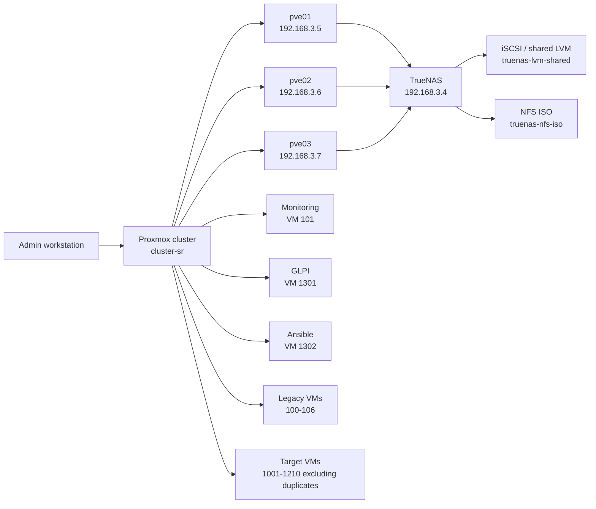
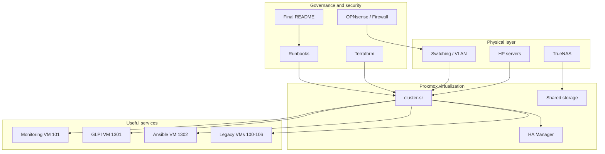
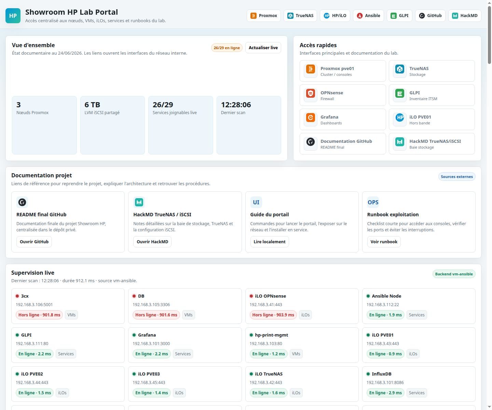
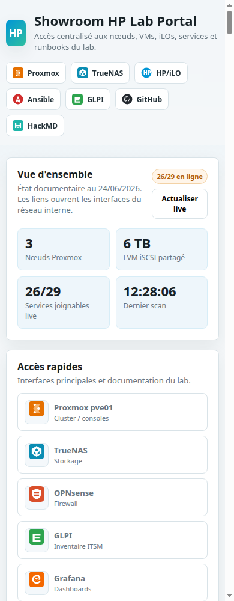
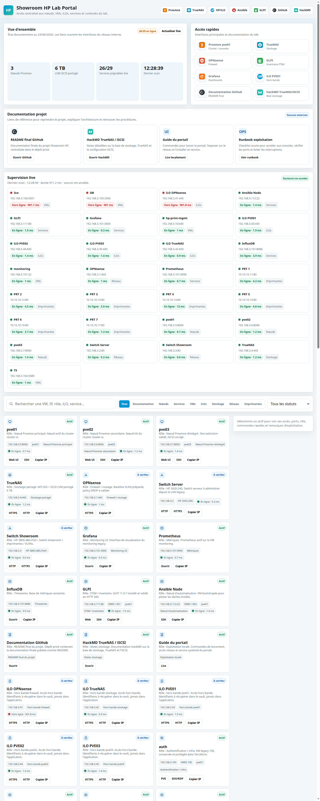
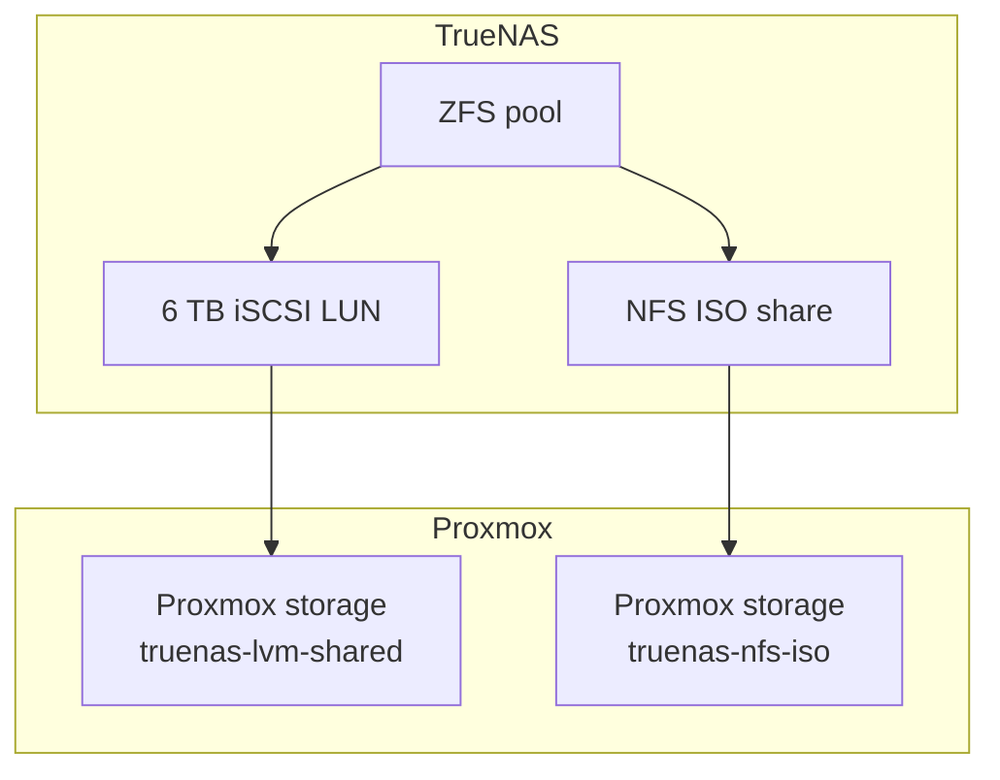
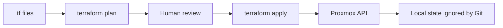
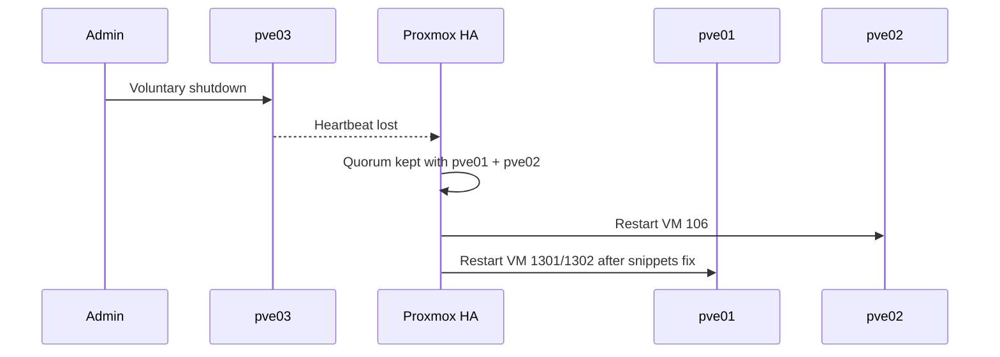
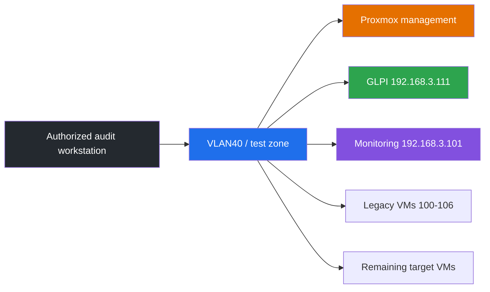
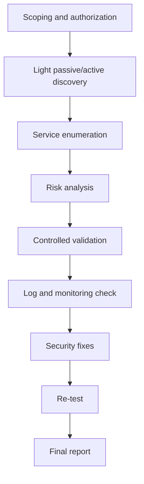

<div align="center">


</div>

# Showroom HP — Final project documentation

> Infrastructure, virtualization, automation and security project for a Showroom HP lab.  
> Last updated: 2026-06-24.

## Executive summary

The **Showroom HP** project built and documented a realistic on-premise platform, based on a three-node **Proxmox VE** cluster, **TrueNAS** shared storage, **Terraform/Ansible** automation, a **GLPI** instance, an existing monitoring stack and network hardening foundations.

The result is an environment that can be used for demonstrations, technical tests, IT inventory, high-availability scenarios and security preparation.

## Contents

- [Global architecture](#global-architecture)
- [Final state](#final-state)
- [Showroom web portal](#showroom-web-portal)
- [Proxmox nodes](#proxmox-nodes)
- [Storage](#storage)
- [Detailed timeline](#detailed-timeline)
- [Log of executed commands](#log-of-executed-commands)
- [Virtualization](#virtualization)
- [Terraform](#terraform)
- [Ansible](#ansible)
- [GLPI](#glpi)
- [Monitoring](#monitoring)
- [High availability](#high-availability)
- [Security](#security)
- [Controlled offensive security](#controlled-offensive-security)
- [OPNsense and network](#opnsense-and-network)
- [GitHub publication](#github-publication)
- [Next steps](#next-steps)

## Global architecture



## Functional view



## Final state

| Area | State |
|---|---|
| Proxmox cluster | 3 nodes, quorum OK |
| Shared storage | TrueNAS iSCSI/LVM active on the nodes |
| ISO/images | TrueNAS NFS active |
| Legacy VMs | `100-106` kept, HA operational |
| Monitoring | VM `101 monitoring` active |
| GLPI | VM `1301 vm-glpi`, HTTP validated |
| Ansible | VM `1302 vm-ansible`, bootstrap completed |
| Showroom web portal | Hosted on `vm-ansible`, reachable at `http://192.168.3.112:8088/` |
| Duplicates | `1000`, `1003`, `1006`, `1100`, `1300` removed |
| Terraform | 42 resources, valid configuration, final plan with no changes |
| Documentation | Final README published as the main documentation |

## Showroom web portal

A dedicated web interface was built to centralize the operation of the lab/showroom.  
It is hosted directly in the showroom environment on the `vm-ansible` VM (`192.168.3.112`) with a permanent `systemd` service.

| Item | Value |
|---|---|
| Internal URL | `http://192.168.3.112:8088/` |
| Hosting VM | `vm-ansible` |
| Directory | `/opt/showroom-lab-portal` |
| Service | `showroom-lab-portal.service` |
| Live API | `/api/health` |
| System API | `/api/system` |

Built-in features:

- quick links to Proxmox, TrueNAS, OPNsense, GLPI, Grafana, iLO, GitHub and HackMD;
- live monitoring from `vm-ansible` with TCP probes on the lab's key ports;
- inventory filterable by type, status, IP, role, VMID and service;
- detail panel for each resource with role, IP, port, VMID, node, live status and useful commands;
- section of ready-to-copy operation commands;
- responsive rendering for desktop or mobile use.

### Desktop view

<p align="center">
  
</p>

### Mobile view

<p align="center">
  
</p>

### Full-page capture of the portal

This capture shows the live monitoring, the quick links and the start of the inventory enriched with the role of each resource.

<p align="center">
  
</p>

## Proxmox nodes

| Node | IP | Role | State |
|---|---:|---|---|
| `pve01` | `192.168.3.5` | Main node / HA active | OK |
| `pve02` | `192.168.3.6` | Secondary node / HA active | OK |
| `pve03` | `192.168.3.7` | Node tested with a shutdown | OK after iSCSI fix |

## Storage



Done:

- creation and validation of the `truenas-lvm-shared` storage;
- migration of the VM disks to the shared storage;
- NFS ISO storage operational;
- validation of `pve-shared` after the restart of `pve03`;
- fix of the `open-iscsi` service on `pve03` after the shutdown test;
- final validation of the storage across the cluster.

## Detailed timeline

### Phase 1 — Creating the Proxmox cluster

Initial situation:

- `pve01` existed as the main node;
- `pve02` was available to join the cluster;
- `pve03` was not yet part of the final scope.

Done:

- preparation of inter-node name resolution;
- `pve02` joined the cluster;
- quorum validation;
- stabilization of the first Proxmox foundation.

Result: working initial cluster, ready for the addition of the third node.

### Phase 2 — Access hardening

Done:

- generation and deployment of administrator SSH keys;
- SSH root access switched to key-only mode;
- creation of the named account `bkh@pve`;
- creation of an API token for automation;
- preparation of the datacenter firewall with an administration allowlist and cluster flows.

Result: cleaner administration access, compatible with Terraform and the operations runbooks.

### Phase 3 — Integrating `pve03` and TrueNAS

Done:

- integration of `pve03` into the final `cluster-sr` cluster;
- standardization of the Proxmox IPs;
- connection to TrueNAS;
- creation of the NFS storage for the ISOs;
- creation of the iSCSI target for the VM disks.

Result: three-node cluster with centralized storage.

### Phase 4 — Migration to shared storage

The solution chosen for the VM disks is:

```text
TrueNAS 6 TB zvol
→ iSCSI target
→ Proxmox LVM pve-shared
→ storage truenas-lvm-shared
```

Done:

- abandonment of approaches unsuited to the HA requirement;
- creation of the shared LVM volume;
- progressive migration of the VM disks;
- storage extension up to 6 TB;
- configuration of iSCSI auto-login;
- addition of automatic VG detection at boot.

Result: VMs can be relocated between nodes with access to the same storage.

### Phase 5 — High availability

Done:

- HA enabled on the critical legacy VMs;
- validation of the three-node quorum;
- live migration test;
- node loss test;
- fix of the HA behavior for cloud-init VMs.

Result: HA validated, with one point of attention identified and then fixed on the cloud-init snippets.

### Phase 6 — Validation tests

| Test | Result |
|---|---|
| Live migration | Validated |
| HA failover | Validated |
| Voluntary shutdown of `pve03` | Quorum kept |
| Return of `pve03` | iSCSI fixed then validated |
| Final Terraform | `No changes` |
| GLPI HTTP | `200 OK` |
| Ansible to GLPI/Ansible | `pong` |

### Phase 7 — Infrastructure as Code

Done with Terraform:

- creation of the VM catalog;
- creation of the ISO VMs;
- creation of the cloud-init Linux VMs;
- import of the legacy VMs;
- protection of the legacy VMs;
- logical and actual removal of the duplicates;
- stabilization of the final plan.

Final state: Terraform manages the current intent without trying to recreate the removed duplicates.

### Phase 8 — `pve03` shutdown test

Observation:

- the cluster stayed quorate with `pve01` and `pve02`;
- VM `106` was restarted by HA;
- the cloud-init VMs revealed a dependency on locally stored snippets.

Fix:

- synchronization of the useful snippets across the nodes;
- removal of the `1300` duplicate;
- restart and validation of the useful VMs;
- repair of `open-iscsi` when `pve03` came back.

Result: incident understood, fixed and documented in the README.

### Phase 9 — Final documentation and publication

Done:

- consolidation of the final documentation in this README;
- removal of the working documentation files it replaced;
- exclusion of sensitive and heavy files;
- creation of a new dedicated GitHub repository;
- minimal publication: `README.md` and `.gitignore` only.

Result: the GitHub repository serves as a clean documentation showcase without publishing the sensitive sources of the lab.

## Log of executed commands

The commands below reproduce the commands executed or used during the project. Secrets, tokens, passwords and private keys are replaced with placeholders.

### Phase 1 — Cluster creation and validation

```bash
hostname
hostname -f
cat /etc/hosts
pvecm status
pvecm nodes
```

Joining a node to the cluster:

```bash
pvecm add <EXISTING_NODE_IP>
pvecm status
pvecm nodes
```

Join through the Proxmox API, used in the initial runbook:

```bash
curl -k -X POST "https://<PVE_IP>:8006/api2/json/cluster/config/join" \
  -H "CSRFPreventionToken: <CSRF_TOKEN>" \
  -H "Cookie: PVEAuthCookie=<AUTH_COOKIE>" \
  --data-urlencode "hostname=<NEW_NODE_IP>" \
  --data-urlencode "password=<ROOT_PASSWORD>" \
  --data-urlencode "fingerprint=<TLS_FINGERPRINT>"
```

### Phase 2 — SSH hardening and Proxmox access

```bash
ssh-keygen -t ed25519 -C "bkh@pop-os-admin"
ssh-copy-id root@192.168.3.5
ssh-copy-id root@192.168.3.6
ssh-copy-id root@192.168.3.7
```

SSH hardening:

```bash
sed -i 's/^#\?PermitRootLogin.*/PermitRootLogin prohibit-password/' /etc/ssh/sshd_config
systemctl restart ssh
ssh -o BatchMode=yes root@192.168.3.5 "hostname && whoami"
```

Named account and API token:

```bash
pveum user add bkh@pve --comment "Named admin account"
pveum aclmod / -user bkh@pve -role Administrator
pveum user token add root@pam automation --privsep 0
pveum aclmod / -token root@pam!automation -role Administrator
```

Proxmox firewall check:

```bash
pve-firewall status
pve-firewall compile
pve-firewall restart
```

### Phase 3 — TrueNAS NFS and iSCSI integration

iSCSI discovery:

```bash
iscsiadm -m discovery -t sendtargets -p 192.168.3.4
iscsiadm -m node -T iqn.2005-10.org.freenas.ctl:iscsi-vm -p 192.168.3.4:3260 --login
iscsiadm -m session
```

Enabling at boot:

```bash
systemctl enable --now open-iscsi
systemctl status open-iscsi --no-pager
```

Adding the NFS ISO storage:

```bash
pvesm add nfs truenas-nfs-iso \
  --server 192.168.3.4 \
  --export /mnt/<POOL>/<DATASET_ISO> \
  --content iso,backup,images

pvesm status
```

### Phase 4 — Creating the shared LVM

Identifying the disk:

```bash
lsblk
ls -l /dev/disk/by-path/
```

Creating the PV/VG:

```bash
pvcreate /dev/<ISCSI_DISK>
vgcreate pve-shared /dev/<ISCSI_DISK>
vgs
vgdisplay pve-shared
```

Adding it to Proxmox:

```bash
pvesm add lvm truenas-lvm-shared \
  --vgname pve-shared \
  --content images,rootdir \
  --shared 1

pvesm status
```

Rescan and detection after reboot:

```bash
iscsiadm -m session --rescan
pvscan --cache
vgdisplay pve-shared
pvesm status
```

Fix applied when `pve03` came back:

```bash
iscsiadm -m node -T iqn.2005-10.org.freenas.ctl:iscsi-vm -p 192.168.3.4:3260 --login
pvscan --cache
vgdisplay pve-shared
systemctl reset-failed open-iscsi
systemctl start open-iscsi
systemctl is-active open-iscsi
```

### Phase 5 — Disk migration and HA

Migrating disks to the shared storage:

```bash
qm config <VMID>
qm move_disk <VMID> scsi0 truenas-lvm-shared --delete 1
qm rescan
qm config <VMID>
```

Creating and checking HA:

```bash
ha-manager status
ha-manager config
ha-manager add vm:<VMID> --state started --group prod-nodes
ha-manager set vm:<VMID> --state started
```

Live migration:

```bash
qm migrate 103 pve01 --online
ha-manager status
qm status 103
```

Supervised HA test:

```bash
systemctl stop corosync
ha-manager status
pvecm status
systemctl start corosync
```

### Phase 6 — Terraform

Initialization and validation:

```bash
cd terraform
terraform init
terraform fmt -check
terraform validate
terraform plan
```

Creating the VM batches:

```bash
terraform plan -out=plan-vms.tfplan
terraform apply plan-vms.tfplan
```

Importing the legacy VMs:

```bash
terraform import 'proxmox_virtual_environment_vm.legacy_vms["legacy-auth"]' 100
terraform import 'proxmox_virtual_environment_vm.legacy_vms["legacy-monitoring"]' 101
terraform import 'proxmox_virtual_environment_vm.legacy_vms["legacy-inventory"]' 102
terraform import 'proxmox_virtual_environment_vm.legacy_vms["legacy-hp-print-mgmt"]' 103
terraform import 'proxmox_virtual_environment_vm.legacy_vms["legacy-ts"]' 104
terraform import 'proxmox_virtual_environment_vm.legacy_vms["legacy-db"]' 105
```

Inspecting the state:

```bash
terraform state list | sort
terraform state show 'proxmox_virtual_environment_vm.linux_vms["vm-glpi"]'
terraform output
```

Final plan used after fixing the duplicates:

```bash
terraform fmt -check legacy_vms.tf linux_vms.tf locals.tf outputs.tf providers.tf variables.tf vms.tf
terraform validate
terraform plan -refresh=false -no-color
```

### Phase 7 — Cloud-init and snippets

Preparing the snippets storage:

```bash
for NODE in 192.168.3.5 192.168.3.6 192.168.3.7; do
  ssh root@$NODE "pvesm set local --content vztmpl,iso,backup,snippets"
done
```

Synchronizing the useful snippets:

```bash
./scripts/proxmox-sync-cloud-init-snippets.sh
```

Commands used by the script:

```bash
ssh root@<NODE> "mkdir -p /var/lib/vz/snippets"
scp terraform/cloud-init/glpi.yaml root@<NODE>:/var/lib/vz/snippets/ci-vm-glpi.yaml
scp terraform/cloud-init/ansible.yaml root@<NODE>:/var/lib/vz/snippets/ci-vm-ansible.yaml
```

### Phase 8 — `pve03` shutdown test

Cluster state before/after:

```bash
pvecm status
ha-manager status
pvesm status
```

Network and storage check when `pve03` came back:

```bash
ssh root@192.168.3.7 "hostname"
ssh root@192.168.3.7 "systemctl is-active open-iscsi"
ssh root@192.168.3.7 "iscsiadm -m session"
ssh root@192.168.3.7 "pvesm status"
ssh root@192.168.3.7 "vgs && lvs"
```

### Phase 9 — Ansible and GLPI

Connectivity tests:

```bash
cd ansible
ansible linux -m ping
ansible vm-glpi -m ping
ansible vm-ansible -m ping
```

Fixing host keys after HA relocation:

```bash
ssh-keyscan -T 8 -t ed25519,rsa 192.168.3.111
ssh-keyscan -T 8 -t ed25519,rsa 192.168.3.112
```

GLPI installation:

```bash
ansible-playbook playbooks/glpi-foundation.yml --syntax-check
ansible-playbook playbooks/glpi-foundation.yml
```

GLPI validation:

```bash
curl -I --max-time 8 http://192.168.3.111
ansible vm-glpi -b -m shell -a 'cd /var/www/glpi && sudo -u www-data php bin/console glpi:system:check_requirements'
ansible vm-glpi -b -m shell -a 'test ! -f /var/www/glpi/install/install.php && echo installer-removed'
```

DB password rotation:

```bash
ansible-playbook playbooks/glpi-rotate-db-password.yml
```

### Phase 10 — Removing duplicates

Removal plan:

```bash
terraform plan -refresh=false -no-color -out=remove-duplicate-vms.tfplan
terraform apply -no-color remove-duplicate-vms.tfplan
```

Cleaning up orphaned references:

```bash
terraform state rm 'proxmox_haresource.linux_vms["vm-monitoring"]'
terraform state rm 'proxmox_virtual_environment_vm.linux_vms["vm-monitoring"]'
```

Cleaning up orphaned snippets:

```bash
for node in 192.168.3.5 192.168.3.6 192.168.3.7; do
  ssh root@$node 'rm -f /var/lib/vz/snippets/ci-vm-monitoring.yaml'
done
```

Final check:

```bash
pvesh get /cluster/resources --type vm | grep -E '(^|[^0-9])(1000|1003|1006|1100|1300)([^0-9]|$)' || true
ha-manager status
terraform state list | grep -E 'vm-monitoring|vms\["(AUTH|SQL|TS|HP-PRINT-MGMT)"\]' || true
terraform plan -refresh=false -no-color
```

### Phase 11 — Minimal GitHub publication

Creating the repository:

```bash
gh repo create xbkh/showroom-hp-infrastructure \
  --private \
  --description "Final documentation and infrastructure as code of the Showroom HP project"
```

Creating the separate local repository:

```bash
git --git-dir=.repo-git --work-tree=. init
git --git-dir=.repo-git --work-tree=. branch -m main
git --git-dir=.repo-git --work-tree=. remote add origin https://github.com/xbkh/showroom-hp-infrastructure.git
```

Deliberately limited publication:

```bash
git --git-dir=.repo-git --work-tree=. add README.md .gitignore
git --git-dir=.repo-git --work-tree=. commit -m "Add final showroom HP documentation"
git --git-dir=.repo-git --work-tree=. push -u origin main
```

GitHub verification:

```bash
gh api repos/xbkh/showroom-hp-infrastructure/git/trees/main?recursive=1 --jq '.tree[].path'
gh repo view xbkh/showroom-hp-infrastructure --json nameWithOwner,visibility,url,defaultBranchRef
```

## Virtualization

### Legacy VMs kept

These VMs already existed and remain the production references. They are imported into Terraform with `ignore_changes = all` protection.

| VMID | Name | Role | State |
|---:|---|---|---|
| 100 | `auth` | Authentication / infrastructure | Running |
| 101 | `monitoring` | Grafana, Prometheus, InfluxDB | Running |
| 102 | `inventory-app` | Existing inventory | Running |
| 103 | `hp-print-mgmt` | HP print management | Running |
| 104 | `TS` | Terminal server | Running |
| 105 | `DB` | Database | Running |
| 106 | `3cx` | Telephony | Running |

### Remaining Terraform VMs

| Batch | VMID | State |
|---|---:|---|
| Windows infrastructure | `1001-1009` excluding duplicates | Created, OS to be installed |
| HP printing / solutions | `1101-1111` | Created, OS to be installed |
| Demo clients | `1200-1210` | Created, OS to be installed |
| Linux cloud-init | `1301-1302` | Active |

### Duplicates removed

| Removed VM | Duplicate of | Decision |
|---:|---|---|
| `1000 AUTH` | `100 auth` | Removed |
| `1003 SQL` | `105 DB` | Removed |
| `1006 TS` | `104 TS` | Removed |
| `1100 HP-PRINT-MGMT` | `103 hp-print-mgmt` | Removed |
| `1300 vm-monitoring` | `101 monitoring` | Removed |

## Terraform

Terraform describes the reproducible Proxmox infrastructure.



Done:

- `bpg/proxmox` provider configured;
- VM catalog in `terraform/locals.tf`;
- creation of the ISO VMs;
- creation of the cloud-init Linux VMs;
- import of the legacy VMs `100-105`;
- protection of the legacy VMs with `ignore_changes = all`;
- addition of the `local.active_vms` and `local.active_linux_vms` filters to avoid recreating the removed duplicates;
- fix of the HA drift by ignoring `node_name` for the Linux VMs;
- final state validated with `terraform plan -refresh=false`: **No changes**.

Important files:

| File | Role |
|---|---|
| `terraform/locals.tf` | VM catalog and active-VM filters |
| `terraform/vms.tf` | ISO VMs |
| `terraform/linux_vms.tf` | Debian cloud-init VMs |
| `terraform/legacy_vms.tf` | Import/protection of the legacy VMs |
| `terraform/outputs.tf` | Clean Terraform outputs |

Git safety:

- `terraform.tfvars` ignored;
- `*.tfstate` ignored;
- `*.tfplan` ignored;
- `.terraform/` ignored;
- the Proxmox ISO and local Excel files are ignored.

## Ansible

Ansible is used to administer the Linux VMs and automate the services.

Done:

- inventory in `ansible/inventory/hosts.yml`;
- dedicated SSH configuration in `ansible/ansible.cfg`;
- fix of the known SSH keys after HA relocation;
- bootstrap of `vm-ansible`;
- complete GLPI installation;
- GLPI DB password rotation playbook;
- monitoring playbook kept only for a possible new target.

Playbooks:

| Playbook | Usage |
|---|---|
| `ansible/playbooks/bootstrap-ansible-node.yml` | Preparation of `vm-ansible` |
| `ansible/playbooks/glpi-foundation.yml` | Complete GLPI installation |
| `ansible/playbooks/glpi-rotate-db-password.yml` | GLPI DB password rotation |
| `ansible/playbooks/monitoring-stack.yml` | Monitoring stack for a new target only |

## GLPI

GLPI is installed on `vm-glpi`.

| Item | Value |
|---|---|
| VMID | `1301` |
| IP | `192.168.3.111` |
| Version | `11.0.7` |
| Web | `http://192.168.3.111` |
| Web server | Nginx |
| PHP | PHP-FPM |
| Database | MariaDB |

Done:

- GLPI installation through Ansible;
- creation of the MariaDB database;
- generation of the DB password on the VM side;
- rotation of the application password after installation;
- removal of the web installer;
- HTTP `200 OK` validation;
- validation of the required GLPI prerequisites.

Still to do:

- change the default accounts;
- import the hardware and VM inventory;
- structure the asset categories;
- document the assignments.

## Monitoring

The active monitoring is the legacy VM `101 monitoring`.

| Service | State |
|---|---|
| SSH | Validated |
| Grafana `3000` | Validated |
| Prometheus `9090` | Validated |
| InfluxDB `8086` | Validated |

Decision: the `1300 vm-monitoring` duplicate was removed.

## High availability

A shutdown test of `pve03` was carried out.



Result:

- quorum kept;
- HA working;
- incident identified on locally stored cloud-init snippets;
- synchronization script created;
- `pve03` reintegrated;
- iSCSI fixed and validated;
- `1300` duplicate removed.

A detailed local report was kept in the project workspace.

## Security

Done:

- SSH hardening;
- root password access disabled;
- named account `bkh@pve` created;
- automation API token created;
- OPNsense baseline prepared;
- Proxmox datacenter firewall prepared;
- TOTP runbook written;
- secrets and Terraform states excluded from the Git repository.

Still to do:

- enable TOTP on `bkh@pve`;
- validate the Proxmox firewall policy in `DROP` mode with emergency access;
- confirm the final role of VLAN40;
- progressively apply the OPNsense baseline.

## Controlled offensive security

This part adds an **offensive / purple team** dimension to the project, but only within an authorized, documented and non-destructive framework. The goal is not to "break" the infrastructure: the goal is to check the real exposure, improve segmentation, feed GLPI, test detections and produce clean technical evidence.

### Objectives

| Objective | Expected result |
|---|---|
| Map the exposure | List of the hosts, ports and services actually visible |
| Validate segmentation | Check which flows pass between VLANs/zones |
| Identify weaknesses | Unnecessary services, outdated versions, open ports |
| Test detections | Generate events visible in logs/monitoring |
| Feed GLPI | Turn the findings into inventory/actions |
| Produce a report | Risks, evidence, recommendations, priorities |

### Rules of engagement

| Rule | Decision |
|---|---|
| Scope | Networks and VMs of the Showroom HP lab that are explicitly authorized |
| Out of scope | Internet, real customers, user data, unvalidated equipment |
| Intensity | Light scans, no denial of service |
| Exploitation | Controlled validation only, after human approval |
| Credentials | No brute force, no password spraying |
| Malware | Forbidden |
| Persistence | Forbidden |
| Exfiltration | Forbidden |
| Traceability | Each test must have a date, target, tool, result and impact |
| Emergency stop | Stop immediately on latency, outage, alert or business impact |

### Recommended test scope



### Offensive methodology



### Test phases

| Phase | Description | Deliverable |
|---|---|---|
| 1. Scoping | Validate the scope, the schedule and the exclusions | Authorization sheet |
| 2. Discovery | Identify the active hosts | Asset list |
| 3. Enumeration | Identify ports, services, versions | Services matrix |
| 4. Analysis | Rank the risks by criticality | Security backlog |
| 5. Validation | Confirm without destructive impact | Controlled evidence |
| 6. Detection | Check the traces in logs/monitoring | Screenshots/logs |
| 7. Fixing | Close ports, patch, filter, document | Action plan |
| 8. Re-test | Confirm the reduction in exposure | Comparison report |

### Non-destructive reconnaissance commands

All the commands below must be run only from an authorized audit workstation and against the validated scope.

Light network discovery:

```bash
mkdir -p reports/offensive
nmap -sn 192.168.3.0/24 -oA reports/offensive/discovery-192-168-3
```

Reasoned TCP scan of the common services:

```bash
nmap -sT -sV --top-ports 100 --reason \
  192.168.3.0/24 \
  -oA reports/offensive/top100-services-192-168-3
```

Targeted scan of a known VM:

```bash
nmap -sV -sC -p 22,80,443,3000,8006,8086,9090 \
  192.168.3.101,192.168.3.111 \
  -oA reports/offensive/key-services
```

Basic HTTP check:

```bash
curl -I http://192.168.3.111
curl -I http://192.168.3.101:3000
curl -k -I https://192.168.3.5:8006
```

Non-intrusive TLS check:

```bash
nmap --script ssl-enum-ciphers -p 443,8006 \
  192.168.3.5,192.168.3.6,192.168.3.7 \
  -oA reports/offensive/tls-proxmox
```

Port inventory to import into GLPI:

```bash
nmap -sV --open -oX reports/offensive/services.xml 192.168.3.0/24
```

### Segmentation tests

Goal: verify that an audit workstation can reach only the necessary services.

```bash
nc -zvw3 192.168.3.5 8006
nc -zvw3 192.168.3.101 3000
nc -zvw3 192.168.3.111 80
nc -zvw3 192.168.3.4 3260
```

Expected result:

| Flow | Expected decision |
|---|---|
| Admin to Proxmox `8006` | Allowed from the admin workstation |
| Admin to Proxmox SSH `22` | Allowed from the admin workstation |
| Monitoring to Proxmox exporters | Allowed if needed |
| Guest VLAN to Proxmox | Blocked |
| Guest VLAN to TrueNAS iSCSI | Blocked |
| Demo VLAN to GLPI HTTP | As needed |

### Purple team scenarios

| Scenario | Controlled action | Expected detection |
|---|---|---|
| Light network scan | `nmap -sn` | Firewall logs or accepted absence |
| Proxmox connection refused | HTTPS attempt from an unauthorized VLAN | OPNsense/Proxmox block |
| GLPI discovery | Simple HTTP request | Nginx logs |
| Forbidden port | `nc` to iSCSI from the wrong zone | Firewall drop |
| Needlessly exposed service | Top-ports scan | Fix ticket |

### Criticality grid

| Level | Example | Action |
|---|---|---|
| Critical | Management access from the guest VLAN | Block immediately |
| High | Admin service exposed without restriction | Restrict by ACL/firewall |
| Medium | Outdated version or overly detailed banner | Plan patch/hardening |
| Low | Expected but undocumented service | Document in GLPI |
| Info | Compliant discovered host | Add to the inventory |

### Expected report

The offensive report must contain:

- date and test window;
- validated scope;
- tools used;
- commands executed;
- discovered hosts;
- exposed ports;
- segmentation gaps;
- screenshots or log extracts;
- ranked risks;
- recommendations;
- re-test after fixing.

### Deliberate limits

This documentation does not provide:

- public vulnerability exploitation;
- payloads;
- authentication bypass;
- persistence;
- lateral movement;
- exfiltration;
- brute force.

These limits keep the project usable as a professional lab, defensible in a client or portfolio context.

### Campaign carried out — 2026-06-24

A first non-destructive campaign was run against the known assets of the lab.

Commands performed:

- targeted scan of the Proxmox, TrueNAS, legacy VM, GLPI and Ansible assets;
- targeted scan of the management ports;
- HTTP check of the exposed services;
- TCP flow tests with `nc`;
- light TLS check on TrueNAS/Proxmox;
- pre-validation of the required paths before firewall hardening.

Main findings:

| Topic | Finding | Priority |
|---|---|---|
| TrueNAS | SSH, HTTP(S), SMB, NFS, iSCSI and rpcbind visible from the admin workstation | P1/P2 depending on VLAN |
| Proxmox | `22`, `8006`, `3128`, `111` visible; `9100` visible on `pve01` | P1/P2 |
| Monitoring | Grafana, Prometheus and InfluxDB reachable | P2 |
| GLPI | GLPI reachable over HTTP only | P2 |
| Inventory | `192.168.3.100` and `192.168.3.102` to reconcile with the real inventory | P2 |

Recommended actions after the campaign:

1. Restrict Proxmox `22/8006` to the admin IPs.
2. Restrict TrueNAS iSCSI/NFS to the Proxmox nodes only.
3. Restrict Prometheus/InfluxDB outside the admin/monitoring VLAN.
4. Add HTTPS to GLPI.
5. Reconcile the discovered hosts in GLPI.
6. Replay the scan after applying the OPNsense baseline.

The detailed report and the Nmap files are kept locally in `reports/offensive/` and are not published in the GitHub repository.

## OPNsense and network

Local artifacts prepared:

| File | Role |
|---|---|
| `opnsense/aliases.csv` | Network aliases |
| `opnsense/baseline-rules.csv` | Rule baseline |
| `docs/operations/opnsense-vlan-baseline.md` | Application guide |
| `docs/operations/vlan40-decision.md` | VLAN40 decision |

Remaining decision: choose the intent of VLAN40 between `corporate`, `guest` or `demo showroom`.

## Summary of delivered items

| Deliverable | State |
|---|---|
| Three-node Proxmox cluster | Done |
| TrueNAS iSCSI/LVM storage | Done |
| TrueNAS NFS ISO storage | Done |
| Legacy VMs imported/protected | Done |
| Terraform catalog | Done |
| Duplicate cleanup | Done |
| GLPI VM installed | Done |
| Ansible VM prepared | Done |
| Legacy monitoring validated | Done |
| `pve03` HA test | Done |
| Security runbooks | Prepared |
| Controlled offensive security campaign | Done |
| OPNsense baseline | Prepared |
| Final README documentation | Done |

## Useful tree

```text
.
├── ansible/                 # Inventory and playbooks
├── docs/                    # Detailed operational runbooks
├── inventory/               # Cleaned inventories and trackers
├── opnsense/                # Firewall baseline
├── reports/                 # Test reports
├── scripts/                 # Validation/synchronization scripts
├── templates/               # CSV and report templates
├── terraform/               # Proxmox Infrastructure as Code
└── README.md                # Final documentation
```

## Files deliberately not published

These files are ignored or deleted locally before the push:

- Proxmox ISO;
- source Excel files;
- `.venv/`;
- `.terraform/`;
- `terraform.tfvars`;
- `terraform.tfstate*`;
- `*.tfplan`;
- raw inventories that may contain sensitive data.

## GitHub publication

The GitHub repository deliberately publishes only:

- `README.md`: final documentation shown on the home page;
- `.gitignore`: safeguard against the accidental publication of sensitive local files.

The Terraform files, Ansible files, inventories, raw reports and scripts stay in the local workspace.

## Local operation commands

Synchronize the useful cloud-init snippets:

```bash
./scripts/proxmox-sync-cloud-init-snippets.sh
```

Check Terraform:

```bash
cd terraform
terraform fmt -check
terraform validate
terraform plan -refresh=false
```

Test Ansible:

```bash
cd ansible
ansible linux -m ping
ansible-playbook playbooks/glpi-foundation.yml --syntax-check
```

Proxmox firewall pre-validation:

```bash
./scripts/validation/proxmox-pre-drop-check.sh
```

## Next steps

1. Configure TOTP for `bkh@pve`.
2. Change the GLPI default accounts.
3. Import the inventory into GLPI.
4. Install the OS on the remaining VMs.
5. Validate the final role of VLAN40.
6. Run a first non-destructive offensive discovery campaign.
7. Apply the OPNsense baseline step by step.
8. Replay a clean HA test.
9. Test a Proxmox backup restore.
10. Switch the Proxmox firewall to `DROP` after full validation.
